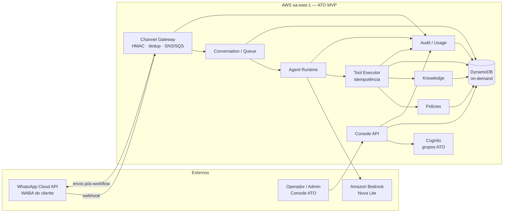

# Arquitetura MVP — ATO

6 nov 2026. Documento de arquitetura alvo do MVP. Sem código. Consolida [`decisoes-mvp.md`](decisoes-mvp.md), [`stack-fit-fase3.md`](anexos/stack-fit-fase3.md), [`evolution-api-fit.md`](anexos/evolution-api-fit.md), [`identidade visual`](identidade.md), [`mapa das 14 telas`](telas.md), preferências e o canvas [ATO — console MVP](https://cursor.com/canvas/store-e933c4ea-dcae-43c5-be9e-dc7378ed0996/7dbf40e4-d47d-40f0-9808-e7cd5c309e1e).

## 1. Contexto e objetivos

**ATO** é a plataforma horizontal de agentes inteligentes da stack Milton Reis / Testto: automatiza processos, executa tarefas e acompanha resultados. Tagline: *Inteligência que faz acontecer.* Domínio de referência: `ato.testto.com.br`.

O MVP prova, no piloto **Miralis**, um ciclo fechado:

1. Mensagem chega no WhatsApp Business Cloud API (número/WABA do cliente).
2. Gateway autentica, deduplica e enfileira.
3. Runtime do agente (Bedrock Nova Lite) decide a próxima ação dentro de políticas.
4. Executor de ferramentas aplica mutações de forma determinística e idempotente.
5. Resposta volta ao WhatsApp só depois da execução (ou handoff humano).
6. Operador/Admin acompanha conversas, agentes, políticas, uso e auditoria no console ATO.

Não é um produto vertical Hostto/PDV. Os Lambdas de imóvel/contrato/PDV permanecem; o ATO entra como **pacotes novos** no monorepo `wmreis-labs/airtestto`, reusando camadas compartilhadas (`shared`, padrões de auth, fila, audit, Bedrock).

### Objetivos do MVP

- Canal oficial Meta Cloud API, sem WhatsApp Web / Evolution no caminho crítico.
- Isolamento multi-tenant lógico (`custom:tenant`), piloto único Miralis.
- Separar **conversação** (LLM) de **execução** (tools com permissão + idempotência).
- Console interno React + MUI 5 + marca ATO (não self-service do cliente final).
- Custo alinhado à conta AWS atual (DynamoDB on-demand `sa-east-1`, serverless).

### Não-objetivos (ver §10)

Billing multi-tenant, marketplace de skills, app do cliente final, Evolution/Baileys, Postgres/pgvector no MVP, LangGraph + Step Functions no mesmo estado, n8n como núcleo.

---

## 2. Diagrama de contexto

Fluxo feliz resumido: Meta → Gateway (verify + HMAC + dedup) → SNS/SQS → Conversation Manager → Agent Runtime → Tool Executor → Send adapter Cloud API → Audit.

---

## 3. Componentes

### 3.1 Channel Gateway

Responsável pelo edge WhatsApp Business Cloud API.

| Responsabilidade | Detalhe |
| --- | --- |
| Verify (GET) | `hub.verify_token` Meta |
| Assinatura (POST) | Validar `X-Hub-Signature-256` (HMAC) **antes** de processar; rejeitar sem assinatura válida |
| Dedup | Chave por `wamid` / message id no Dynamo; at-least-once seguro |
| Normalização | Evento interno único (tenant, contato, texto/mídia, timestamps) |
| Roteamento | `phone_number_id` → `tenantId` (Miralis no piloto) |
| Fan-out | Publicar SNS → SQS (+ DLQ); **não** chamar LLM no webhook |
| Envio | Adapter Cloud API (texto, template, mídia, status) **somente** após Tool/Workflow Executor |
| Status | Consumer de delivery/read/failed → conversa + auditoria |

**Explicitamente fora:** WhatsApp Web, QR, Baileys, whatsmeow, Evolution API como sidecar ou gateway. Ideias reaproveitáveis da Evolution (contrato de eventos, mapeamento Number ID → conexão, superfícies de envio) — não o produto. Ver [`evolution-api-fit.md`](anexos/evolution-api-fit.md).

### 3.2 Agent Runtime

- Escolhe a próxima ação a partir do histórico da conversa, versão publicada do agente e ferramentas habilitadas.
- LLM padrão: **Bedrock Nova Lite** (região Bedrock já usada pela stack, tipicamente `us-east-1`), atrás da interface própria em `packages/ai` (padrão Hostto).
- Critério de troca de modelo: fixtures Miralis PT-BR com qualidade insuficiente ou falha sistemática de tools — não troca por hábito.
- Modo sombra opcional (`OFF | SHADOW | ON` + allowlist por tenant), no espírito do interpretador de vendas atual.
- Não embute execução mutável: devolve intenção/tool call tipada para o executor.

### 3.3 Tool Executor (idempotência)

- Registry de ferramentas com permissão por **tenant + agente + versão**.
- Execução determinística: validação de input, checagem de política, gravação de `tool_executions` com `idempotency_key`.
- Replay da mesma chave devolve o mesmo resultado (padrão webhook contrato / `X-Operation-Id` PDV).
- Confirmação explícita antes de mutações sensíveis (agenda, pedido, etc.), quando a política exigir.
- Handoff humano: tool/status que congela respostas do agente na conversa.

### 3.4 Conversation / Queue

- Estado da conversa: contato, agente/versão, status (`open`, `waiting_human`, `closed`, …), última mensagem, fila de turns.
- Desacoplamento webhook → runtime via SNS/SQS/DLQ (reuso do padrão `packages/message`).
- Uma conversa ativa por contato+canal+tenant no MVP; histórico append-only lógico.

### 3.5 Policies

- Limites do que o agente pode fazer: tools permitidas, confirmação obrigatória, horários, allowlists.
- Escopo por tenant (Miralis) e por agente/versão publicada.
- Sem motor genérico de workflow visual no MVP; políticas são dados + checagens no executor.

### 3.6 Knowledge

- Base de conhecimento **simples** no Dynamo (documentos/trechos por tenant), suficiente para grounding do piloto Miralis.
- Sem Postgres + pgvector no MVP (custo/ops). Embeddings/RAG avançado ficam para quando o volume pagar o piso.

### 3.7 Console API

- API REST (API Gateway + Lambdas) para o front ATO: empresas, agentes, versões, conversas, tools, canais, políticas, pessoas, uso, auditoria.
- Auth Cognito; authorizer amarra claim `custom:tenant` (modo sessão — **sem** fallback `system` frouxo).
- Configuração pela equipe interna; sem cadastro público nem self-service do cliente final.

### 3.8 Audit / Usage

- Trilha assíncrona (fila → Dynamo), no padrão `packages/audit`.
- Eventos: webhook aceito/rejeitado, turn LLM, tool execution (sucesso/falha/idempotent hit), envio WhatsApp, handoff, login console.
- Logs JSON com `traceId`, `tenantId`; PII fora de prompt/log quando possível.
- Uso: contadores por tenant (mensagens, tokens aproximados, tools) para a tela Admin — não billing.

---

## 4. Multi-tenancy

| Aspecto | Decisão MVP |
| --- | --- |
| Claim | Cognito `custom:tenant` |
| Resolução | Só modo sessão (claim ↔ header `x-tenant` coerentes). Proibido cair em `system` por subdomínio/header solto no caminho ATO |
| Piloto | **Miralis** único primeiro; WABA/número do cliente Miralis |
| Isolamento | `tenantId` em toda chave Dynamo / item; filtros na aplicação |
| Grupos Cognito | **Admin plataforma**, **Operador**, **Gestor cliente**, **Auditoria** |
| Tenant Manager | Reuso/evolução de `packages/tenant` + metadados de canal (WABA, `phone_number_id`, secret do token) |

Admin plataforma pode listar empresas; Operador/Gestor/Auditoria ficam no tenant ativo (barra do console). Sem planos/billing multi-tenant no MVP.

---

## 5. Dados (DynamoDB)

- Região operacional: **`sa-east-1`**, on-demand (pay-per-request).
- Bedrock continua cross-region conforme a stack atual (`us-east-1`), se necessário.
- Sem RDS/Aurora no MVP.

### Padrões de chave (alto nível)

| Entidade | Padrão sugerido | Notas |
| --- | --- | --- |
| Tenant / Canal | `TENANT#<id>` / `CHANNEL#whatsapp` | Mapa `phone_number_id` → tenant |
| Agente / Versão | `TENANT#<id>` / `AGENT#<id>` + `VERSION#<n>` | Só versão publicada atende canal |
| Conversa | `TENANT#<id>` / `CONV#<id>` | GSI por contato + status |
| Mensagem / Turn | `CONV#<id>` / `MSG#<ts>#<id>` | Append; dedup separado |
| Dedup webhook | `DEDUP#<wamid>` | TTL curto |
| Tool execution | `TENANT#<id>` / `TOOLX#<idempotency_key>` | Resultado imutável no replay |
| Knowledge | `TENANT#<id>` / `KB#<docId>` | Trechos/metadados |
| Audit / Usage | `TENANT#<id>` / `AUDIT#<ts>#<id>` | Consumo assíncrono |
| Políticas | `TENANT#<id>` / `POLICY#<agentId>` | Allowlists e flags |

Detalhamento de GSIs e TTLs fica para o desenho de implementação; aqui só o contrato de partição por tenant.

---

## 6. Frontend vs backend

| | Backend `wmreis-labs/airtestto` | Front **repo GitHub novo** |
| --- | --- | --- |
| Papel | Channel Gateway, runtime, tools, APIs, dados, audit | Console ATO (Operador + Admin) |
| Stack | TypeScript, Lambda, CDK, Dynamo, Cognito, Bedrock | React + **MUI 5** + **Plus Jakarta Sans** + tokens ATO |
| Reuso | `shared`, auth/session authorizer (modo rígido), message/SNS-SQS, audit, `ai`/Bedrock | Inspiração Hostto (CRA/Vite + MUI), **sem** carregar dívida dos fronts antigos (tenant no build, pele Atende) |
| O que não vai | UI React no monorepo backend | Lambdas, webhook Meta, secrets WABA |
| Telas | — | 14 telas do canvas (Visão geral, Atendimento, Agenda, Pendências, Conhecimento, Implantação; Empresas, Agentes, Canal WhatsApp, Integrações, Políticas, Pessoas, Uso/auditoria) |
| Marca | — | ATO (não Atende); sidebar grafite + conteúdo claro; ver [`identidade visual`](identidade.md) |

Shell: estrutura/fluxos do mock Operador/Admin; sem registry genérico estilo Odoo no MVP (lista/form densos bastam). WhatsApp embutido no console, construtor visual e marketplace ficam fora.

---

## 7. Amplify e ambientes

| Ambiente | Uso | Notas |
| --- | --- | --- |
| **dev** | Integração diária, WABA de teste / sandbox Meta se houver | Branch de desenvolvimento → Amplify app/env `dev` |
| **prod** | Piloto Miralis | Branch estável; subdomain sob `ato.testto.com.br` (ex. console) |

- Front: Amplify Hosting, **subdomínio**, apps/envs **separados** dev/prod (não um único stage ambíguo).
- Backend airtestto: stacks CDK por stage (alinhar nomes `dev`/`prod` com o front); secrets WABA/tokens no Secrets Manager, nunca no build do front.
- Cognito: pools ou app clients por ambiente; grupos ATO criados nos dois.
- Variáveis do front: só URLs de API e client Cognito do ambiente — **tenant vem da sessão**, não de `REACT_APP_TENANT`.

---

## 8. Segurança

1. **Webhook Meta:** HMAC `X-Hub-Signature-256` obrigatório; verify token só no GET; corpo não processado se assinatura falhar.
2. **Least privilege:** roles IAM por pacote/Lambda (Dynamo só das tabelas do domínio; Bedrock só no runtime; Secrets só no gateway/send).
3. **Tenant:** authorizer rejeita mismatch claim/header; tools sempre recebem `tenantId` do contexto, nunca do body cru.
4. **Tokens WABA:** Secrets Manager; rotação manual no MVP; console não expõe o token em claro após gravação.
5. **Cognito:** quatro grupos; APIs checam grupo + tenant. Auditoria read-mostly.
6. **PII:** minimizar em logs/prompts; audit sem payload completo de documento sensível quando possível.
7. **Envio:** somente server-side pós-executor; sem “send Message” livre a partir do LLM.
8. **Não usar** sessão WhatsApp Web (ban, queda, sem WABA) em Depilk/Miralis/produção ATO.

---

## 9. Escopo MVP / não-objetivos

### No escopo

- Channel Gateway Cloud API + envio pós-workflow.
- Runtime Nova Lite + tool executor idempotente.
- Conversa, handoff humano, políticas básicas, knowledge simples.
- Console API + front novo (14 telas, marca ATO).
- Cognito com 4 grupos; piloto Miralis; audit/usage.
- Packages novos em airtestto; Amplify dev/prod.

### Fora do MVP

- Billing / planos multi-tenant self-service.
- Marketplace de skills / construtor visual de ferramentas.
- App do cliente final (só console interno).
- WhatsApp Web, Evolution, Baileys, whatsmeow.
- Postgres + RLS + pgvector.
- LangGraph e Step Functions controlando o mesmo estado; n8n como núcleo; workflow-lab como runtime.
- Multi-agente colaborativo; OpenTelemetry completo (CloudWatch/X-Ray bastam no início).
- Reuso do admin Hostto/PDV como UI do ATO.

---

## 10. Pacotes / módulos sugeridos em airtestto

Novos packages TypeScript no monorepo (nomes alinhados ao padrão `packages/*` existente). Domínios Hostto/PDV **não** são movidos.

| Package | Responsabilidade |
| --- | --- |
| `packages/ato-channel` | Webhook Meta, HMAC, dedup, normalização, send adapter, status consumer, CDK |
| `packages/ato-conversation` | Conversas, turns, fila SNS/SQS consumers, handoff |
| `packages/ato-agent` | Definição de agente, versões, publish, Agent Runtime |
| `packages/ato-tools` | Registry, executor, `tool_executions`, idempotência |
| `packages/ato-policy` | Políticas e checagens pré-execução |
| `packages/ato-knowledge` | Documentos/trechos por tenant |
| `packages/ato-console-api` | Rotas REST do console (ou composição em `packages/api` apontando para handlers ATO) |
| `packages/ato-usage` | Agregados de uso (se não couber só em audit) |

### Reuso explícito (não duplicar)

- `packages/shared` — middleware tenant **modo sessão**, logging, contratos Zod, idempotência helpers.
- `packages/auth` — Cognito; **estender grupos** para Admin plataforma / Operador / Gestor cliente / Auditoria (sem reutilizar cegamente Admin/Operacional/Financeiro/Leitor do Hostto no console ATO).
- `packages/tenant` — CRUD tenant + campos de canal WhatsApp.
- `packages/message` — padrões SNS/SQS/DLQ.
- `packages/audit` — fila e tabela de eventos (ou especialização ATO).
- `packages/ai` — Bedrock / Nova Lite atrás da interface existente.

Composition root: registrar stacks ATO em `packages/api` (ou bin CDK dedicado `ato`) sem acoplar property/contract/pdv.

---

## 11. Riscos em aberto

| Risco | Impacto | Mitigação inicial |
| --- | --- | --- |
| Qualidade Nova Lite em PT-BR / tool calling Miralis | Atendimento ruim ou tools erradas | Fixtures de conversa + critério explícito de upgrade de modelo |
| Aprovação WABA / templates Meta do cliente | Bloqueio de envio proativo | Começar com janela de 24 h + templates mínimos; checklist de onboarding Miralis |
| Dedup incompleto sob retry Meta | Cobrança dupla de tool / spam | Tabela dedup + idempotency_key obrigatória em mutação |
| Vazamento cross-tenant (resolver frouxo legado) | Incidente de dados | Authorizer ATO só modo sessão; testes de mismatch |
| Custo Bedrock acima do esperado no piloto | Estoura teto da conta | Cap de tokens/dia por tenant; SHADOW antes de ON |
| Escopo de telas (14) vs tempo de entrega | Front atraso | Priorizar Atendimento + Agentes + Canal + Auditoria; restante em fatias |
| Pressão por “atalho” Evolution/Web | Ban / ops always-on / sem HMAC | Decisão travada: Cloud API only; ver evolution-api-fit |
| Secrets WABA no mesmo padrão de contas Inter nomeadas | Acoplamento operacional | Secret por tenantId; sem hardcode Miralis em código |
| Knowledge sem busca vetorial | Respostas fracas | Curadoria manual de trechos no piloto; revisitar pgvector depois |
| Grupos Cognito Hostto × ATO no mesmo User Pool | Confusão de papéis | Decidir pool dedicado ATO vs grupos prefixados; documentar no auth |

---

## 12. Referências

- [`decisoes-mvp.md`](decisoes-mvp.md) — decisões travadas
- [`stack-fit-fase3.md`](anexos/stack-fit-fase3.md) — o que copiar / construir / não fazer na stack
- [`evolution-api-fit.md`](anexos/evolution-api-fit.md) — por que não Evolution/Web no caminho crítico
- [`identidade visual`](identidade.md) — marca e tokens
- [`mapa das 14 telas`](telas.md) — shell e fluxos
- Canvas: [ATO — console MVP](https://cursor.com/canvas/store-e933c4ea-dcae-43c5-be9e-dc7378ed0996/7dbf40e4-d47d-40f0-9808-e7cd5c309e1e)
- Preferências do projeto (store)
